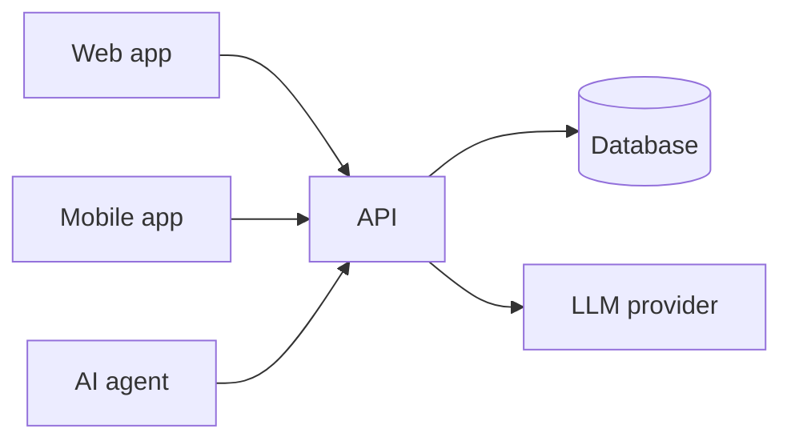

# Project name

A collaborative plateform to reference the software alternatives that can manages common task to help people keeping their old devices and reduce e-waste.

## Authors

| Name | GitHub | Main responsibilities |
|------|--------|-----------------------|
| Raphaël Letourneur | @raphltr | Developper |
| Oïlhan Mercul | @OilhanMercul | Developper |

<!-- Lab repository: one row. Project repository: both team members. -->

## Live system

| Part | URL |
|------|-----|
| Web app | … |
| API (+ docs) | … |
| Health check | … |
| Mobile app | build instructions below / APK in Releases |

## Architecture

See [docs/architecture.md](docs/architecture.md).



## Stack

| Part | Technology |
|------|------------|
| Backend | Node.js + Express |
| Web front end | React + Vite |
| Database / ORM | PostgreSQL + Prisma |
| Mobile | To be decided |
| Cloud | GitHub Actions + GHCR + Render |
| LLM provider | To be decided |

Reasons: see [docs/decisions/](docs/decisions/).

## Running locally

### Prerequisites
- Node.js 22 or later
- npm
- Docker and Docker Compose

### 1. Configuration (secrets)
Copy `.env.example` to `.env` and set local values :

```bash
cp .env.example .env
```
*(Under Windows PowerShell: `Copy-Item .env.example .env`)*

**Never commit real secrets.** The `.env` file is ignored by Git.

### 2. Install dependencies
```bash
npm install
```

### 3. Start local PostgreSQL and Keycloak
Start PostgreSQL and the local OIDC identity provider with Docker Compose:

```bash
docker compose up -d postgres keycloak
```

Keycloak is available at `http://localhost:8081` and PostgreSQL on port `5432`.
The named volumes preserve data between restarts.

### 4. Apply database migrations and seed data

```bash
npx prisma migrate deploy
npx prisma db seed
```

If you want to reset the db for running the tests again :
WARNING : all the data will be lost 
```bash
npx prisma migrate reset
```
An other solutions for the test would be to run them in another database test

For a new local schema change, use `npx prisma migrate dev --name <description>`.

If Prisma reports `P1000: Authentication failed`, check that the password in
`DATABASE_URL` matches `POSTGRES_PASSWORD`. PostgreSQL stores the password in
the named volume during its first initialization; changing `.env` later does
not change that stored password. For a disposable local database, stop the
stack and remove only the PostgreSQL volume:

```powershell
docker compose down
docker volume rm project-raph-oilhan_postgres-data
docker compose up -d postgres keycloak
```

Then repeat the migration and seed commands. Do not remove the volume if it
contains data that must be kept.

### 5. Provision test accounts
Provision the test users in Keycloak (`user1` and `admin`) with the automated setup script:

```bash
npm run setup:keycloak
```

### 6. Start the API
```bash
npm run dev
```
The API is available at `http://localhost:8080` (health check at `http://localhost:8080/health`).

### 7. Run tests locally

- **Typecheck and build:**
  ```bash
  npm run build
  ```
- **Lint OpenAPI specification:**
  ```bash
  npm run lint:openapi
  ```
- **API integration tests (Bruno via CLI):**
  Ensure Keycloak and the API are running, then run:
  ```bash
  npm run test:api
  ```
- **API integration tests (Bruno via GUI):**
  1. Open Bruno and choose **Open Collection** > `api-tests/bruno/`.
  2. Select the `local` environment.
  3. Right-click on the collection and choose **Run**. Tokens are now automatically generated and shared between requests without manual copy/paste.

## CI/CD Pipeline (GitHub Actions)

The project includes an automated GitHub Actions pipeline (`.github/workflows/ci.yml`) triggered on pull requests, pushes to `main`, and manual execution (`workflow_dispatch`).

### Prerequisites for CI
Configure the following **Repository Secrets** in GitHub (**Settings > Secrets and variables > Actions > New repository secret**):
- `KEYCLOAK_ADMIN_PASSWORD`: Keycloak bootstrap admin password.
- `TEST_USER_PASSWORD`: Test user password (`user1`).
- `TEST_ADMIN_PASSWORD`: Test application administrator password (`admin`).

### Pipeline structure
1. **Build & Typecheck:** Compiles TypeScript (`npm run build`) and prepares Prisma client generation.
2. **Lint OpenAPI:** Validates `docs/api/openapi.yaml` with Redocly CLI.
3. **API Integration Tests (Bruno):** Starts Keycloak, dynamically provisions ephemeral test accounts, starts the API, executes the Bruno collection via `@usebruno/cli`, and tears down containers cleanly. Anticipates PostgreSQL service container and Prisma migrations.

### Mobile app
How to build and run it, and how to point it to a local or production API.

## Documentation

| Document | Content |
|----------|---------|
| [docs/proposal.md](docs/proposal.md) | Problem, users, user stories |
| [docs/data-model.md](docs/data-model.md) | ER diagram |
| [docs/architecture.md](docs/architecture.md) | Components and deployment |
| [docs/api/openapi.yaml](docs/api/openapi.yaml) | REST API contract |
| [docs/agent.md](docs/agent.md) | Agent tools and guardrails |
| [docs/decisions/](docs/decisions/) | Architecture decision records |
| [docs/ai-usage-log.md](docs/ai-usage-log.md) | How we used AI tools |
