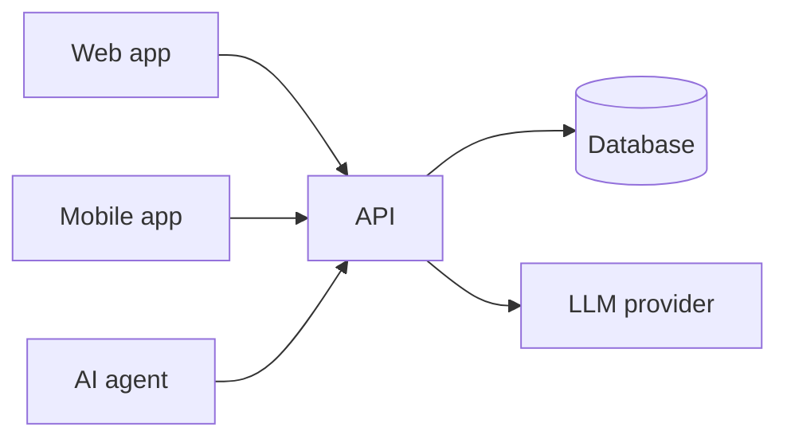

# Project name

A collaborative plateform to reference the software alternatives that can manages common task to help people keeping their old devices and reduce e-waste.

## Authors

| Name | GitHub | Main responsibilities |
|------|--------|-----------------------|
| Raphaël Letourneur | @raphltr | Developper |
| Oïlhan Mercul | @OilhanMercul | Developper |

<!-- Lab repository: one row. Project repository: both team members. -->

## Live system

| Part | URL |
|------|-----|
| Web app | … |
| API (+ docs) | … |
| Health check | … |
| Mobile app | build instructions below / APK in Releases |

## Architecture

See [docs/architecture.md](docs/architecture.md).



## Stack

| Part | Technology |
|------|------------|
| Backend | Node.js + Express |
| Web front end | React + Vite |
| Database / ORM | PostgreSQL + Prisma |
| Mobile | To be decided |
| Cloud | GitHub Actions + GHCR + Render |
| LLM provider | Google Gemini API |

Reasons: see [docs/decisions/](docs/decisions/).

## Local setup and development

### Prerequisites

- Docker and Docker Compose
- Node.js 22 and npm only if you want to run the API or scripts directly on
  your computer

### First-time setup (Docker only)

No Node.js installation on the host computer is required to build and run the
full application in Docker.

1. Create `.env` if it does not exist:

   ```powershell
   if (-not (Test-Path .env)) { Copy-Item .env.example .env }
   ```

   Open `.env` and replace the placeholder passwords. Keep
   `DATABASE_URL` consistent with `POSTGRES_USER`, `POSTGRES_PASSWORD`, and
   `POSTGRES_DB`. `.env` is ignored by Git; never commit its secrets. These
   values are read by Compose and passed into the containers.

### Option A: run everything in Docker

Build and start the complete application:

```bash
docker compose up --build -d
```

Compose performs the setup in the required order:

- Starts PostgreSQL and Keycloak, which store their state in named volumes.
- Imports the Keycloak realm configuration.
- Waits for PostgreSQL, then runs database migrations and seed data.
- Runs the Keycloak account setup container. It creates or updates the
  `user1` and `admin` test accounts using the passwords in `.env`.
- Starts the API after database setup and Keycloak account setup succeed.

You do **not** need to run `npm ci`, Prisma commands, or
`npm run setup:keycloak` on your computer for this Docker-only workflow. The
Docker build installs the Node.js dependencies inside the images, and Compose
runs the initialization commands in containers.

The API is available at `http://localhost:8080` and its health endpoint is
`http://localhost:8080/health`. Check container status with:

```bash
docker compose ps
```

The account setup container reads the configured test passwords when it runs.
If you change those passwords in `.env`, the next setup run updates the
Keycloak test accounts to match.

### Later Docker launches

When you want to start the application again without rebuilding:

```bash
docker compose up -d
```

The database and Keycloak users persist in their volumes, so you do not need
to recreate `.env` or manually initialize the accounts. If source code or
dependencies changed, rebuild with:

```bash
docker compose up --build -d
```

### Option B: run the API on your computer

Use this option during development if you want `tsx watch` to reload the API
when you edit source files. This option requires Node.js and npm on the host.
Install dependencies once after cloning (and again when `package-lock.json`
changes), then start the services and initialize the database:

```bash
npm ci
docker compose up -d postgres keycloak
npx prisma migrate deploy
npx prisma db seed
docker compose run --build --rm keycloak-setup
```

Compose starts only PostgreSQL and Keycloak in this mode, so migrations and
seed are run manually. The Keycloak setup still runs in a container; no
separate host-side setup command is needed. Then start the API:

```bash
npm run dev
```

The API is available at `http://localhost:8080`; its health endpoint is
`http://localhost:8080/health`. Keep this terminal open while using the API.

On later launches of this host-development mode, start the services and API:

```bash
docker compose up -d postgres keycloak
npm run dev
```

You only need to run `npx prisma migrate deploy` when the database is new or
new migrations have been added. Run `npx prisma db seed` for a new database
or to restore the initial test data. Re-run
`docker compose run --build --rm keycloak-setup` after deleting the Keycloak
volume or when you want to apply changed test passwords.

### Run the Bruno integration tests in Docker

This command runs the tests without installing Node.js or npm on the host.
It starts any required services and waits for the API to become healthy:

```bash
docker compose --profile test run --build --rm api-tests
```

The test container gets the passwords from `.env` and connects to the API and
Keycloak over the Compose network. The collection includes delete requests,
so some test data is removed. Re-run the seed if you want to restore the
initial records.

For a clean first-install test, remove the existing containers and data
volumes, then rebuild and start the project:

```bash
docker compose down --volumes --remove-orphans
docker compose up --build -d
docker compose ps
docker compose --profile test run --build --rm api-tests
```

This deletes all local PostgreSQL data and Keycloak state, including the test
accounts. Keep `.env`: it contains the local settings needed to initialize
the fresh containers. The `up` command recreates the realm, database schema,
seed data, and Keycloak test accounts automatically. No host-side Node.js
installation is used.

`docker compose down` stops containers but preserves data. Use
`docker compose down --volumes --remove-orphans` only when you intentionally
want a full reset. If Prisma reports `P1000: Authentication failed`, ensure
the `DATABASE_URL` password matches `POSTGRES_PASSWORD`; changing `.env`
does not change credentials already stored in an existing volume.

### Optional host-side checks

If Node.js is installed on the host, you can also run:

```bash
npm run build
npm run lint:openapi
```

## CI/CD

GitHub Actions runs on pull requests, pushes to `main`, and manual dispatch.
It builds and typechecks the API, lints the OpenAPI specification, then runs
the Bruno integration tests against the Docker Compose stack. Add these
repository secrets under **Settings > Secrets and variables > Actions**:

- `KEYCLOAK_ADMIN_PASSWORD`
- `TEST_USER_PASSWORD`
- `TEST_ADMIN_PASSWORD`

### Production deployment

For production, configure the API and web application in Render, use a
managed PostgreSQL database and a production identity provider, and store
connection details and credentials in the cloud provider's environment
secrets. Apply database migrations during deployment with
`npx prisma migrate deploy`; do not run the development seed against
production data. Configure HTTPS and use `/health` as the API health check.

### Mobile app

How to build and run it, and how to point it to a local or production API.

## Documentation

| Document | Content |
|----------|---------|
| [docs/proposal.md](docs/proposal.md) | Problem, users, user stories |
| [docs/data-model.md](docs/data-model.md) | ER diagram |
| [docs/architecture.md](docs/architecture.md) | Components and deployment |
| [docs/api/openapi.yaml](docs/api/openapi.yaml) | REST API contract |
| [docs/agent.md](docs/agent.md) | Agent tools and guardrails |
| [docs/decisions/](docs/decisions/) | Architecture decision records |
| [docs/ai-usage-log.md](docs/ai-usage-log.md) | How we used AI tools |
