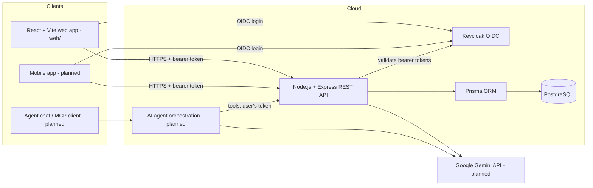
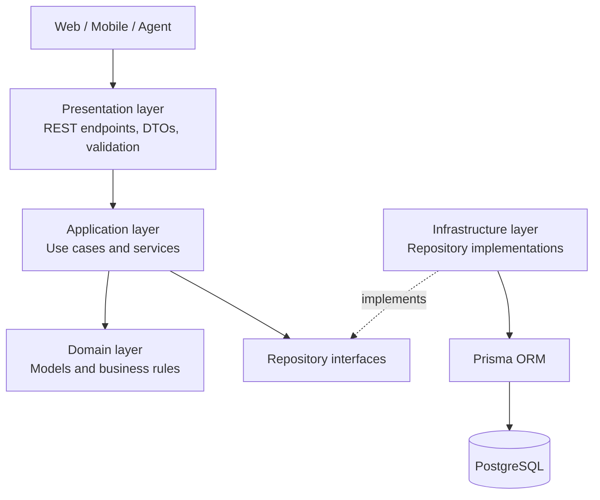
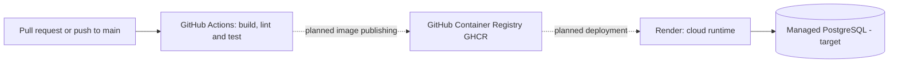

# Architecture

## Components

The backend API and a minimal React + Vite web client are implemented. The mobile
and AI agent components below describe the target architecture; they are not
implemented in this repository yet.



Update this diagram as the system evolves.

## Layers (backend)

The backend follows Clean Architecture: HTTP and database details stay outside the
business rules. Dependencies point inward.



### Source layout

```text
src/
├── app.ts                         # Composes the API and connects its dependencies
├── server.ts                      # Starts the HTTP server
├── presentation/
│   ├── http/
│   │   ├── routes/                # Express route handlers
│   │   ├── middleware/            # Request validation and user helpers
│   │   ├── auth.ts                # Keycloak token validation
│   │   ├── errors.ts              # HTTP errors and Problem Details
│   │   └── express.d.ts           # Express request type augmentation
│   └── dto/
│       ├── request-dtos.ts        # Zod request schemas and inferred input types
│       ├── public-user-dto.ts     # Public user response mapping
│       └── software-alternative-dto.ts
├── application/
│   ├── services/                  # User and alternative use cases
│   ├── ports/                     # Repository interfaces
│   ├── page.ts                    # Shared paginated result type
│   └── errors.ts                  # Application errors
├── domain/
│   ├── user-domain.ts             # User model and access rules
│   └── alternative-domain.ts      # Alternative model and business rules
└── infrastructure/
    └── prisma/                    # Prisma client and repository implementations

web/                                # React + Vite client; OpenAPI-generated API types
prisma/                             # Database schema, migrations and seed data
docs/api/openapi.yaml               # REST API contract
api-tests/bruno/                    # HTTP integration tests
infra/keycloak/                     # Keycloak realm configuration
scripts/                            # API test runner and Keycloak setup
```

### Presentation layer

Handles HTTP, authentication, request validation and response DTOs. Routes call
application services; they do not contain business rules or access the database.

### Application layer

Coordinates user and software-alternative use cases, enforces role and ownership
checks, and calls repository interfaces. It does not depend on Prisma.

### Domain layer

Contains the `User` and `SoftwareAlternative` models and their business/access rules.
These rules are functions in the domain files.

### Infrastructure layer

Implements the repository interfaces with Prisma. It maps database records to domain
models and keeps persistence-specific code outside the application and domain layers.

### Request flow

1. Express matches the URL to a route mounted in `src/app.ts`.
2. The route runs the required authentication middleware and validates request data.
3. The application service applies use-case and access rules, then calls a repository
   interface.
4. The Prisma repository reads or writes PostgreSQL and returns a domain model.
5. The route maps the result to a response DTO and sends the HTTP response.

Errors are passed to the central Express error handler in `src/app.ts`, which converts
HTTP and application errors into Problem Details responses.

### Web client

The web client is deliberately organized as a single small React application rather
than a layered frontend framework. `web/src/App.tsx` contains the current screens and
interactions, `web/src/api.ts` is the typed API adapter, and `web/src/auth.ts` integrates
the public `project-web` Keycloak OIDC client with Authorization Code + PKCE. A silent
SSO check lets public pages load anonymously and recognizes an existing Keycloak
session without forcing the visitor through a login page. API requests use a bearer
token and target the `project-api` audience; the API checks signature, issuer, expiry
and audience.

The API enables CORS only for the exact HTTPS origins listed in
`CORS_ALLOWED_ORIGINS` (HTTP is accepted for localhost development); it does not enable
credentialed cross-origin cookies. `WEB_ORIGIN` configures the Keycloak SPA callback,
and `VITE_API_URL` configures the API origin in the browser. The API types are
regenerated from `docs/api/openapi.yaml` during the web build. Unsupported API
operations and fields are shown as disabled controls rather than simulated in the
browser.

## Authentication & authorization

Keycloak authenticates users and issues bearer tokens. The API validates tokens using
Keycloak's public signing keys and provisions an application user when needed.

The API supports `user` and `admin` roles. Authorization and ownership checks are
enforced by application services; clients cannot bypass these checks by calling the
API directly.

## Deployment

Docker Compose runs the API, PostgreSQL and Keycloak locally, applies migrations and
seed data, and provisions local Keycloak test accounts. GitHub Actions builds the API,
validates the OpenAPI contract and runs Bruno integration tests. GHCR and Render are
the documented cloud targets; the current CI workflow does not deploy the application.


